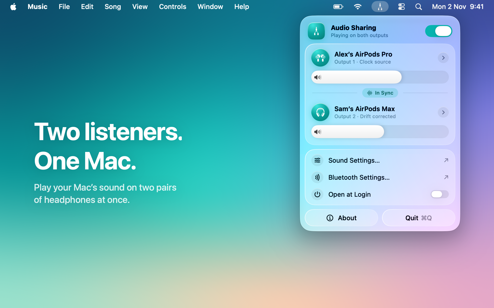
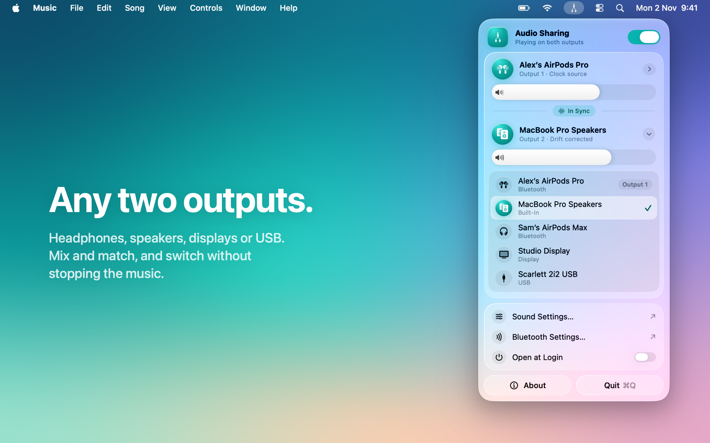
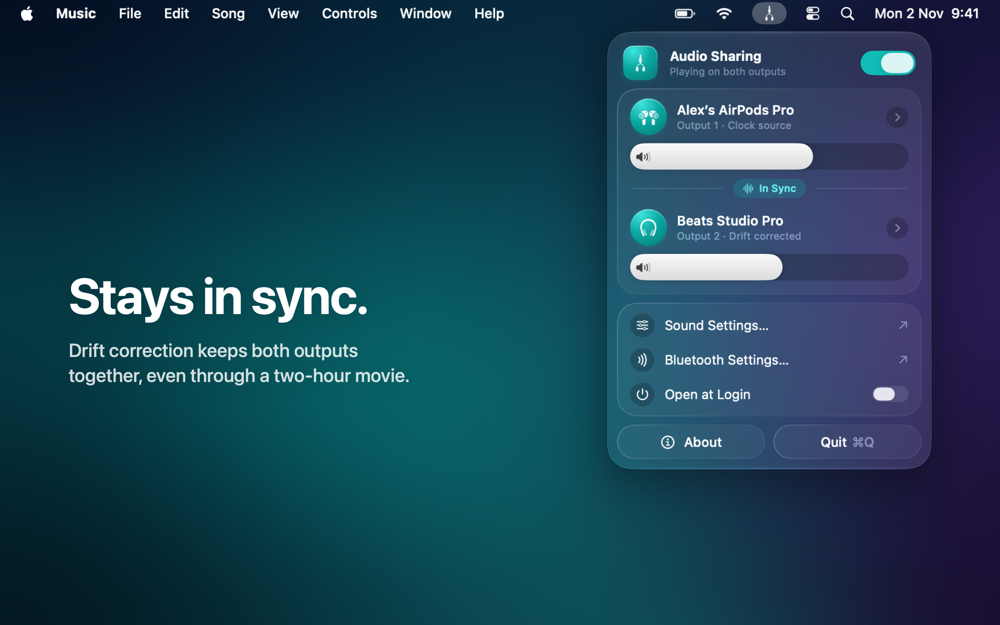
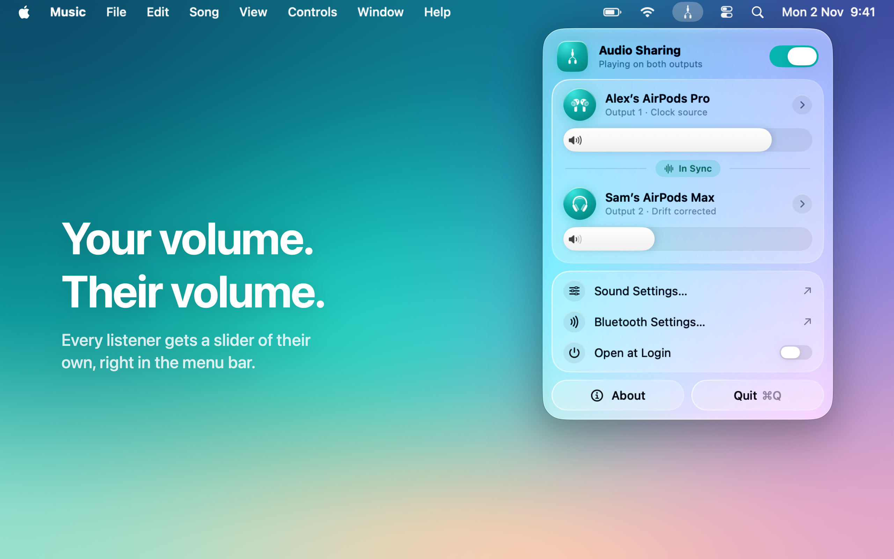
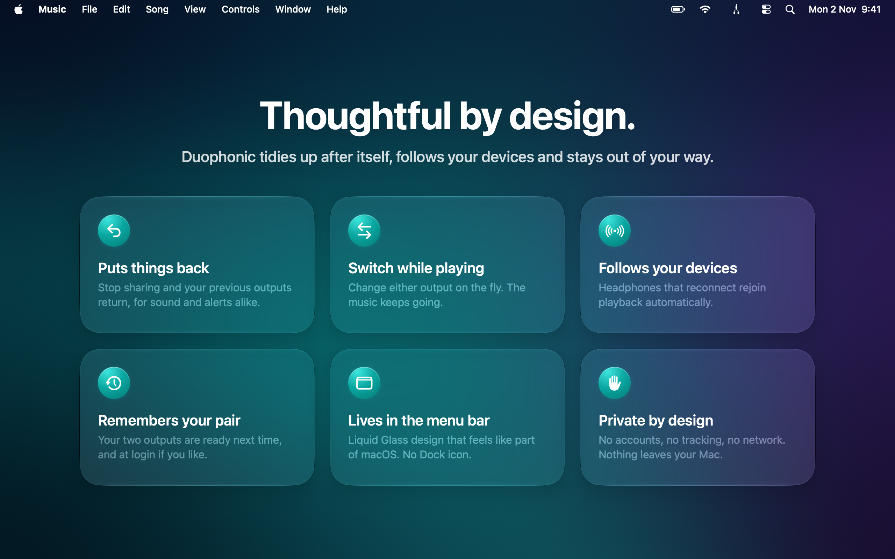

# Mac App Store listing

Everything the App Store product page needs, ready to paste into App Store Connect or upload with [fastlane `deliver`](https://docs.fastlane.tools/actions/deliver/), whose folder layout this follows.

```
appstore/
├── metadata/            name, subtitle, description, keywords… per language (en-US, de-DE)
│   └── review_information/   contact and notes for App Review
└── screenshots/en-US/   2560 × 1600 screenshots, in order
```

## Screenshots

| | |
|---|---|
|  |  |
|  |  |
|  | |

They aren't mockups: each one is a SwiftUI preview in [`Duophonic/Marketing/AppStoreScreenshots.swift`](../Duophonic/Marketing/AppStoreScreenshots.swift) that puts the real menu bar window on a staged desktop, so its Liquid Glass picks up the wallpaper as it does on a real Mac. After changing the UI, regenerate them with Xcode open:

```bash
swift scripts/export-app-store-screenshots.swift      # all of them
swift scripts/export-app-store-screenshots.swift 2 3  # just some
```

Xcode only renders previews at full resolution up to about 1500 × 975 pixels, so the script renders each screenshot as 16 tiles and stitches them together. It takes about a minute per screenshot. The first run asks you to allow the connection in Xcode.

The App Store shows the first three screenshots in search results, so the most important message comes first. They're 16:10 at 2560 × 1600, one of the four sizes the Mac App Store accepts, without an alpha channel. The German listing uses the English screenshots, because the app isn't localized yet.

## Listing

| Field | en-US | Limit |
|---|---|---|
| Name | Duophonic: Share Audio | 30 |
| Subtitle | Two headphones, one Mac | 30 |
| Promotional text | Movie night on a train? … | 170 |
| Keywords | multi-output, dual, output, bluetooth, … | 100 bytes |
| Primary / secondary category | Utilities / Music | |

- **Name and subtitle carry the most search weight.** "Share Audio" and "Two headphones" are what people type when they look for this. The keywords don't repeat any of their words, because the App Store already indexes the name and subtitle.
- **No Apple trademarks in the name, subtitle or keywords.** App Review rejects "AirPods" there (guidelines 2.3.7 and 5.2.5). Saying it works with AirPods in the description is fine.
- **Promotional text** can be changed at any time without a new app version. Use it for seasonal hooks, such as travel or holidays.
- **The description makes no claims beyond the README.** It deliberately doesn't promise AirPlay, whose latency hasn't been tested with a multi-output device. It lists the limitations up front, which helps prevent one-star reviews.

## App Store Connect questionnaire

- **App Privacy:** Data Not Collected. The app has no network access, which the sandbox enforces, since it has no network entitlement. This matches [`Duophonic/PrivacyInfo.xcprivacy`](../Duophonic/PrivacyInfo.xcprivacy), which declares the app's only required-reason API, UserDefaults (reason CA92.1).
- **Privacy policy URL:** [`PRIVACY.md`](../PRIVACY.md) on GitHub, which is required even when no data is collected.
- **Age rating:** answer "None" everywhere → 4+.
- **Export compliance:** answered by `ITSAppUsesNonExemptEncryption = NO` in Info.plist, so uploads don't ask.
- **Content rights:** no third-party content.
- **Pricing:** your call.

## Before submitting

These steps need the paid Apple Developer Program membership:

1. Register the bundle ID `com.juri1212.Duophonic` and create the app record in App Store Connect (platform macOS, primary language English (U.S.)).
2. Archive with Product → Archive and upload. The GitHub release workflow builds Developer ID builds for direct download. Those can't go to the App Store, which needs Apple Distribution signing.
3. Test the TestFlight build on a clean Mac account: the App Store build is signed differently, so check that sharing turns on, Open at Login works, and quitting restores the output.
4. Upload the listing: `fastlane deliver --metadata_path appstore/metadata --screenshots_path appstore/screenshots --skip_binary_upload`, or paste the text files into App Store Connect.
5. App Review gets [`review_information/notes.txt`](metadata/review_information/notes.txt). It explains that Duophonic only lives in the menu bar, which reviewers otherwise sometimes report as "the app doesn't launch". Add a phone number in `phone_number.txt`; App Store Connect asks for one.

Only ship sandboxed builds: the Mac App Store requires the App Sandbox. The Conversation Awareness branch (`t3code/airpods-conversation-awareness-toggle`) removes it, so it can't be part of an App Store version.
